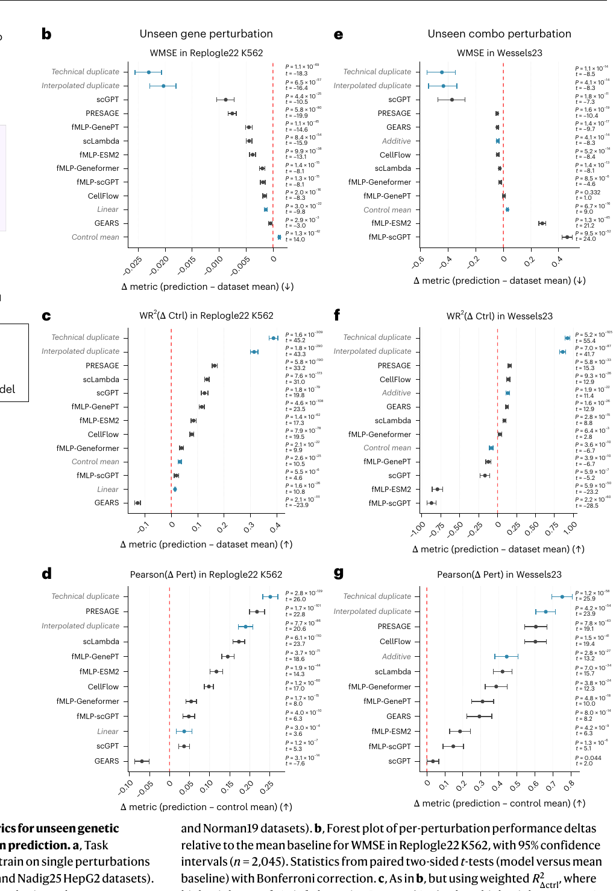
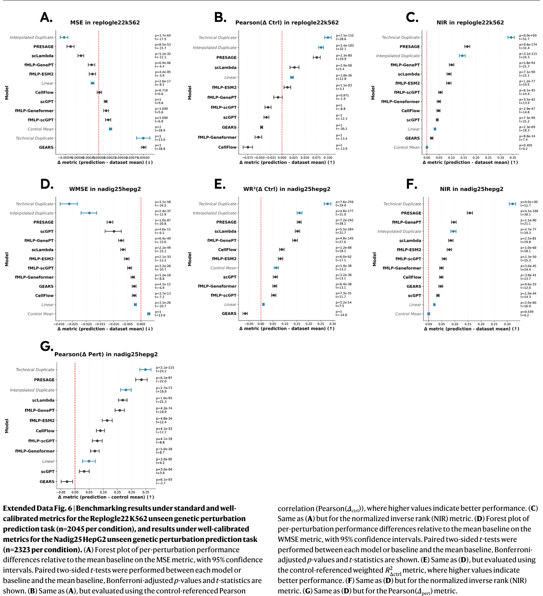
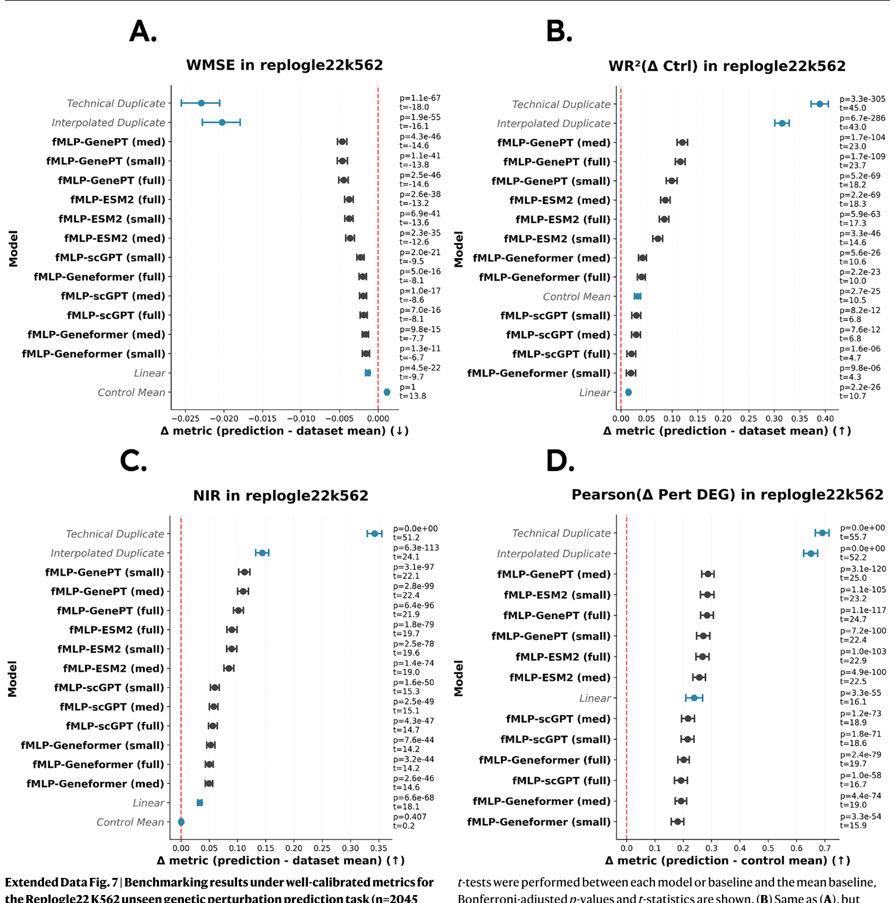

# 扰动模型的 baseline 及性能报告

> 本地 Markdown 稿（与 HTML 同步维护）。线上页：[perturbation-baselines.html](./perturbation-baselines.html) · <https://cangiolo.github.io/archive/perturbation-baselines.html>

## 结论

**模型排序**与 [Miller et al.](https://doi.org/10.1038/s41587-026-03307-w) 的 Figure / Extended Data 中一致。

**评测任务与指标：**本复现覆盖未见单基因扰动三个数据集：HepG2（Nadig25）、K562（Replogle22）、Jurkat（Nadig25）；共 18 个指标。


## 现有指标及计算方案

[Miller et al.](https://doi.org/10.1038/s41587-026-03307-w) 用校准后的指标说明：即便较早期的深度模型，在部分指标上也大多能超过无信息 baseline；更新的模型（如 PRESAGE）更进一步。以 Fig. 2b（K562，WMSE）为例，从矩阵到森林图的处理如下。

- **预测矩阵合并为扰动级向量（每轮按扰动计算，不是逐细胞比）。**每个测试扰动把细胞对半：GT 半聚成真值伪批量 $y$（GT），模型输出同维伪批量 $\hat{y}$（预测）。GEARS 等对抽样 control 取均值后再加扰动效应。Mean 基线则是本折训练扰动伪批量的等权平均 $\mu_{\mathrm{all}}$。

- **每个扰动算一次 WMSE。**用 GT 半细胞相对「其余非对照扰动」细胞做 t-test（overestim_var），得到 $t_g$（$|t_g|$ 反映该基因相对其他扰动的特异程度）；对 $|t|$ min–max 后再平方得基因权重 $w_g$（权重只来自 GT，避免泄漏）。然后

$$
\mathrm{WMSE}_i=\frac{\sum_g w_g(\hat y_g-y_g)^2}{\sum_g w_g}.
$$

其中 $\hat y$ 为预测伪批量、$y$ 为 GT 伪批量、$g$ 为基因。对 Mean 用同一套 $y,w$，把 $\hat y$ 换成 $\mu_{\mathrm{all}}$，得到 $\mathrm{WMSE}_i^{\mathrm{Mean}}$。

- **Fig. 2b 画的不是绝对 WMSE，而是差值。**每个扰动：$\Delta_i=\mathrm{WMSE}_i(\text{模型})-\mathrm{WMSE}_i(\text{Mean})$。WMSE 越低越好，所以 $\Delta<0$（点在 0 左侧）= 打过 Mean。图注 $n=2045$ 就是这类成对差值的扰动数。

- **汇总成一行森林图。**对所有 $\Delta_i$ 取均值 $\mu_\Delta$；95% CI 用扰动级 bootstrap（文中 10,000 次）；再对「模型 vs Mean」做配对 t 检验（Bonferroni）。一点 + 横线 = 这一行的 $\mu_\Delta$ 与 CI，不是五折先平均再画。




*图 1. Miller et al., Nat Biotechnol（2026），Figure 2b–g（已裁去 a 面板任务示意）。相对 Mean 的森林图：左列 Replogle22 K562 未见单基因；右列 Wessels23 未见组合。*



*图 2. 同文 Extended Data Fig. 6。上排 Replogle22 K562（MSE / Pearson(Δctrl) / NIR）；下排 Nadig25 HepG2（WMSE / 加权 R²Δctrl / NIR / Pearson(Δpert)）。*



*图 3. 同文 Extended Data Fig. 7。仅 Replogle22 K562 未见单基因任务；比较 fMLP 在 GenePT / ESM2 / scGPT / Geneformer 等嵌入与规模下的表现。*

## HepG2（Nadig25）

作者预处理 109,183×8,746；2322 非对照扰动。GEARS / Mean / Inter.Dup / Control / Tech.Dup 来自 GEARS 正式轮拼接；Linear、fMLP–Geneformer 来自各自 REPORT。与 Miller 文印刷表三位小数对照时，非 DEG 多项对齐；DEG 绝对分不对齐。

### 拼接 mean（全 18 项）

数字为 pooled mean。Tech.Dup / Inter.Dup 为正对照。 可评规模：Linear n≈2100 · Mean n≈2302 · GEARS n≈2302 · fMLP–Geneformer n≈2260 · Inter.Dup n≈2302 · Control n≈2302 · Tech.Dup n≈2302。

| 指标                  | Linear   | Mean     | GEARS    | fMLP–Geneformer | Inter.Dup | Control  | Tech.Dup |
| ------------------- | -------- | -------- | -------- | --------------- | --------- | -------- | -------- |
| MSE                 | 0.009176 | 0.009262 | 0.009773 | 0.009565        | 0.008256  | 0.010175 | 0.011582 |
| WMSE                | 0.048182 | 0.048218 | 0.045429 | 0.045157        | 0.029393  | 0.051076 | 0.022033 |
| MAE                 | 0.065883 | 0.066002 | 0.068912 | 0.067324        | 0.064048  | 0.067635 | 0.078303 |
| WMAE                | 0.151231 | 0.151649 | 0.147979 | 0.143912        | 0.133974  | 0.150447 | 0.111575 |
| Pearson(Δctrl)      | 0.287    | 0.262    | 0.206    | 0.188           | 0.294     | 未定义      | 0.299    |
| Pearson(Δpert)      | 0.080    | 未定义      | 0.060    | 0.121           | 0.231     | 0.052    | 0.300    |
| R²(Δctrl)           | 0.027    | 0.012    | −0.089   | −0.048          | 0.063     | −0.010   | −0.398   |
| R²(Δpert)           | −0.003   | −0.010   | −0.115   | −0.077          | 0.052     | −0.068   | −0.406   |
| WR²(Δctrl)          | −0.062   | −0.091   | −0.100   | −0.035          | 0.070     | −0.027   | 0.188    |
| WR²(Δpert)          | −0.012   | −0.026   | −0.035   | 0.016           | 0.147     | −0.007   | 0.267    |
| NIR                 | 0.513    | 0.500    | 0.535    | 0.549           | 0.594     | 0.500    | 0.820    |
| PDS                 | 0.513    | 0.500    | 0.531    | 0.545           | 0.564     | 0.500    | 0.788    |
| MSE(DEGs)           | 0.082    | 0.083    | 0.072    | 0.073           | 0.043     | 0.092    | 0.027    |
| MAE(DEGs)           | 0.190    | 0.190    | 0.182    | 0.177           | 0.145     | 0.192    | 0.119    |
| Pearson(Δctrl DEGs) | 0.396    | 0.382    | 0.287    | 0.239           | 0.543     | 未定义      | 0.493    |
| Pearson(Δpert DEGs) | 0.155    | 未定义      | 0.090    | 0.091           | 0.446     | −0.058   | 0.491    |
| R²(Δctrl DEGs)      | −0.254   | −0.303   | −0.405   | −0.361          | −0.074    | −0.389   | −0.095   |
| R²(Δpert DEGs)      | −0.391   | −0.426   | −0.419   | −0.386          | −0.167    | −0.430   | −0.061   |

\**相对 Mean：**GEARS 的 MSE +5.5%、WMSE −5.8%（16 项中胜 7）。相对 Miller 文印刷点：GEARS Pearson(Δctrl) −0.012、NIR −0.011。

## K562（Replogle22）

GO 可评约 2029；Linear n=1855（仅表达靶）；fMLP–Geneformer n=1986（all_embedded，剔除缺嵌入 58）。简报未单列 Tech/Inter 拼接行，故下表不含这两列。

### 拼接 mean（全 18 项）

GEARS 五折完成后四档齐全；排序与 Miller 文印刷表一致。 可评规模：Linear n≈1855 · Mean n≈2029 · GEARS n≈2029 · fMLP–Geneformer n≈1986 · Control n≈2029。

| 指标                  | Linear   | Mean     | GEARS    | fMLP–Geneformer | Control  |
| ------------------- | -------- | -------- | -------- | --------------- | -------- |
| MSE                 | 0.004814 | 0.004835 | 0.005944 | 0.005040        | 0.005099 |
| WMSE                | 0.034434 | 0.033802 | 0.033510 | 0.032008        | 0.034976 |
| MAE                 | 0.047700 | 0.047659 | 0.054299 | 0.048975        | 0.048241 |
| WMAE                | 0.118511 | 0.118101 | 0.118731 | 0.111511        | 0.117038 |
| Pearson(Δctrl)      | 0.242    | 0.207    | 0.153    | 0.143           | 未定义      |
| Pearson(Δpert)      | 0.079    | 未定义      | 0.019    | 0.115           | 0.060    |
| R²(Δctrl)           | 0.009    | −0.008   | −0.323   | −0.093          | −0.020   |
| R²(Δpert)           | −0.009   | −0.021   | −0.348   | −0.108          | −0.046   |
| WR²(Δctrl)          | −0.042   | −0.069   | −0.178   | −0.033          | −0.037   |
| WR²(Δpert)          | −0.020   | −0.035   | −0.149   | −0.004          | −0.020   |
| NIR                 | 0.517    | 0.500    | 0.518    | 0.555           | 0.500    |
| PDS                 | 0.518    | 0.500    | 0.516    | 0.552           | 0.500    |
| MSE(DEGs)           | 0.052    | 0.052    | 0.049    | 0.047           | 0.055    |
| MAE(DEGs)           | 0.157    | 0.156    | 0.155    | 0.144           | 0.156    |
| Pearson(Δctrl DEGs) | 0.294    | 0.268    | 0.220    | 0.183           | 未定义      |
| Pearson(Δpert DEGs) | 0.159    | 未定义      | 0.096    | 0.121           | −0.052   |
| R²(Δctrl DEGs)      | −0.201   | −0.260   | −0.378   | −0.263          | −0.286   |
| R²(Δpert DEGs)      | −0.256   | −0.307   | −0.381   | −0.268          | −0.309   |

\**排序：**Pearson Linear > Mean > GEARS > fMLP；NIR fMLP > GEARS ≈ Linear > Mean。MSE(DEGs) 上 Linear/Mean 差约 0.0002 互换，不算结构性翻车。

## Jurkat（Nadig25）

Miller 文印刷表 **无** Jurkat 的 Linear/GEARS/fMLP 行。下表为 Linear 报告中的**共同支持集 n=2108**（六模型同扰动）；fMLP–Geneformer 不在该 matched 表内，另列 all_embedded n=2283。

### 拼接 mean（matched n=2108）

同集公平比较；Inter.Dup / Tech.Dup 为正对照。 可评规模：Linear n≈2108 · Mean n≈2108 · GEARS n≈2108 · Inter.Dup n≈2108 · Control n≈2108 · Tech.Dup n≈2108。

| 指标                  | Linear   | Mean     | GEARS    | Inter.Dup | Control  | Tech.Dup |
| ------------------- | -------- | -------- | -------- | --------- | -------- | -------- |
| MSE                 | 0.008155 | 0.008265 | 0.009916 | 0.007653  | 0.008852 | 0.011440 |
| WMSE                | 0.051241 | 0.052720 | 0.051595 | 0.026     | 0.055263 | 0.022    |
| MAE                 | 0.063023 | 0.063274 | 0.071463 | 0.062132  | 0.064510 | 0.077350 |
| WMAE                | 0.148972 | 0.150581 | 0.151579 | 0.129479  | 0.150582 | 0.110300 |
| Pearson(Δctrl)      | 0.246    | 0.236    | 0.167    | 0.290     | 未定义      | 0.286    |
| Pearson(Δpert)      | 0.050    | 未定义      | 0.016    | 0.211     | 0.031    | 0.273    |
| R²(Δctrl)           | 0.013    | 0.010    | −0.254   | 0.063     | −0.020   | −0.433   |
| R²(Δpert)           | −0.014   | −0.020   | −0.295   | 0.039     | −0.065   | −0.461   |
| WR²(Δctrl)          | −0.050   | −0.060   | −0.137   | 0.195     | −0.054   | 0.280    |
| WR²(Δpert)          | −0.040   | −0.053   | −0.129   | 0.213     | −0.064   | 0.303    |
| NIR                 | 0.509    | 0.500    | 0.517    | 0.586     | 0.500    | 0.806    |
| PDS                 | 0.508    | 0.500    | 0.513    | 0.538     | 0.500    | 0.769    |
| MSE(DEGs)           | 0.067    | 0.070    | 0.067    | 0.038     | 0.074    | 0.025    |
| MAE(DEGs)           | 0.177    | 0.180    | 0.182    | 0.140     | 0.182    | 0.115    |
| Pearson(Δctrl DEGs) | 0.337    | 0.324    | 0.241    | 0.600     | 未定义      | 0.588    |
| Pearson(Δpert DEGs) | 0.126    | 未定义      | 0.076    | 0.519     | −0.080   | 0.575    |
| R²(Δctrl DEGs)      | −0.278   | −0.295   | −0.413   | 0.055     | −0.352   | 0.094    |
| R²(Δpert DEGs)      | −0.351   | −0.367   | −0.430   | 0.008     | −0.385   | 0.102    |

### fMLP–Geneformer（Jurkat，另口径）

fMLP–Geneformer all_embedded n=2283（缺嵌入 −63）。勿与上表 n=2108 硬比。无文中印刷对照行。

| 指标                  | fMLP–Geneformer |
| ------------------- | --------------- |
| MSE                 | 0.008447        |
| WMSE                | 0.047257        |
| MAE                 | 0.064283        |
| WMAE                | 0.142419        |
| Pearson(Δctrl)      | 0.179           |
| Pearson(Δpert)      | 0.082           |
| R²(Δctrl)           | −0.090          |
| R²(Δpert)           | −0.110          |
| WR²(Δctrl)          | −0.056          |
| WR²(Δpert)          | −0.035          |
| NIR                 | 0.535           |
| PDS                 | 0.530           |
| MSE(DEGs)           | 0.061           |
| MAE(DEGs)           | 0.166           |
| Pearson(Δctrl DEGs) | 0.249           |
| Pearson(Δpert DEGs) | 0.100           |
| R²(Δctrl DEGs)      | −0.344          |
| R²(Δpert DEGs)      | −0.357          |

\**内部序（matched）：**Pearson Inter.Dup > Tech.Dup > Linear > Mean > GEARS；NIR Tech.Dup ≫ Inter.Dup > GEARS ≳ Linear ≈ Mean。

## 模型配置

表中模型名可悬停；完整配置如下。

### GEARS

\**GEARS 0.1.2（原生）。**每个数据集（HepG2 / K562 / Jurkat）独立五折训练与评分。

```
hidden                 64
GO / Gene GNN          各 1 层
decoder                16
两图邻居               20
coexpression 阈值      0.4
epochs                 10
batch                  32
optimizer              Adam lr=0.001, weight_decay=0.0005
scheduler              StepLR 每 epoch ×0.5
loss                   原生四次方 + direction_lambda=0.1
uncertainty            False
checkpoint             val top20-DE MSE
共表达图               仅本折 train 细胞
predict                对 300 个抽样 control 取均值
```

### Linear

\*\*Ahlmann-Eltze Linear。\*\*伪批量 PCA（10 维）加岭回归 Y≈G W P。

```
PCA                    n_components=10, random_state=42
ridge                  G_ridge=P_ridge=0.1
靶基因                 仅表达矩阵中出现的靶；缺行不补零
对齐                   HepG2/K562 非 DEG 12 项对齐印刷表三位小数
```

### fMLP–Geneformer

\*\*fMLP + Geneformer-V2-104M。\*\*冻结 Geneformer 词嵌入，其上训练 MLP probe；非动态 cell embedding。

```
嵌入                   Geneformer-V2-104M word_embeddings
查表                   作者 h5ad 内 20,271×768 静态；不微调 Transformer
网络                   768→512→512→128(latent)→512→512→全部输出基因
激活                   LeakyReLU(0.2)
loss                   绝对表达 MSE
optimizer              Adam lr=0.001
batch                  256
scheduler              StepLR 每 30 epochs ×0.2
seed                   42
epochs                 100
缺嵌入剔除             HepG2 −62 · K562 −58 · Jurkat −63
```

### Mean

\*\*Dataset Mean（负对照）。\*\*训练扰动伪批量的等权平均；Miller 用作负对照。

```
定义                   本折训练非对照扰动的 pseudobulk 等权平均
加权                   不按细胞数加权
注意                   Pearson(Δpert) 对自身未定义
```

### Control

\*\*Control Mean（负对照）。\*\*对照细胞均值基线。

```
定义                   作者 ctrl_baseline
注意                   Pearson(Δctrl) 对自身未定义（预测位移为零向量）
```

### Tech.Dup

\*\*Technical duplicate（正对照）。\*\*同扰动另一半细胞预测 GT 半；实验可及的上界。

```
半分裂                 first_half=GT · second_half=TD
DEG 权重               TD 不参与，避免泄漏
```

### Inter.Dup

\*\*Interpolated duplicate（正对照）。\*\*TD 与 Mean 按 DEG 显著性逐基因插值；用于指标校准。

```
公式                   μ_ID = α ⊙ μ_TD + (1−α) ⊙ μ_all
α                      1 − P_DEG（仅用 TD 半独立 DEG）
弱扰动                 贴近 Mean
强扰动                 贴近 Tech.Dup
```

\*\*数据集对应训练：\*\*GEARS / fMLP / Linear 均在 HepG2、K562、Jurkat 上分别拟合五折；Mean / Control / Tech.Dup / Inter.Dup 为每折派生基线，不是可学习模型。

## 指标释义（18 项）

下列定义对齐 Miller Methods 与本复现 REPORT：真值为 GT 半伪批量；对照为 `ctrl_baseline`；Δpert 参考本折训练 Mean；权重为 GT |t| min–max 后再平方；DEG 为 adjusted-P 最小 100 个；R² 下限 −1；NIR/PDS 严格小于、排除自身、平局不计。公式按操作定义写出；加权与检索的实现细节以 REPORT / 上游 `data_manager.py` 为准。

### MSE：均方误差

意义：预测与真值在全部基因上的均方误差，越低越好。

计算过程：对每个测试扰动，取 GT 半的伪批量表达 y 与预测 ŷ，在全基因组上算 (ŷ−y)² 的均值；再对扰动等权平均。

公式：

$$
\mathrm{MSE}(\hat y,y)=\frac1G\sum_{g=1}^{G}(\hat y_g-y_g)^2
$$

### WMSE：加权均方误差

意义：按扰动效应强弱给基因加权的 MSE，强调强扰动基因上的误差。

计算过程：权重来自 GT 半相对其余非对照扰动的 t-test\_overestim\_var：对 |t| 做 min–max 归一化后再平方；再算加权 MSE。Miller Methods 称 weighted error metrics 与先验 WMSE 工作一致。

公式：

$$
w_g=\Bigl(\mathrm{minmax}(|t_g|)\Bigr)^2,\quad \mathrm{WMSE}=\frac{\sum_g w_g(\hat y_g-y_g)^2}{\sum_g w_g}
$$

### MAE：平均绝对误差

意义：全基因绝对误差均值；Miller 认为整体校准弱于 MSE。

计算过程：与 MSE 相同的 y / ŷ，改为 |ŷ−y| 的均值。

公式：

$$
\mathrm{MAE}(\hat y,y)=\frac1G\sum_{g=1}^{G}|\hat y_g-y_g|
$$

### WMAE：加权平均绝对误差

意义：与 WMSE 同权重的加权 MAE。

计算过程：权重定义同 WMSE；误差改为绝对误差。

公式：

$$
\mathrm{WMAE}=\frac{\sum_g w_g|\hat y_g-y_g|}{\sum_g w_g}
$$

### Pearson(Δctrl)：相对对照的 Pearson 相关

意义：预测与真值相对对照基线的位移向量的相关系数；衡量方向与相对幅度。

计算过程：Δctrl：ŷ−μ\_c 与 y−μ\_c，μ\_c 为对照细胞均值（ctrl\_baseline）。零向量时未定义（如 Control 自身）。

公式：

$$
\mathrm{Pearson}(\Delta\mathrm{ctrl})=\mathrm{corr}(\hat y-\mu_c,\; y-\mu_c)
$$

### Pearson(Δpert)：相对训练均值的 Pearson 相关

意义：相对本折训练扰动均值 μ\_all 的位移相关；用于减弱对照偏置。

计算过程：Δpert：ŷ−μ\_all 与 y−μ\_all。Mean 基线自身该指标未定义。

公式：

$$
\mathrm{Pearson}(\Delta\mathrm{pert})=\mathrm{corr}(\hat y-\mu_{\mathrm{all}},\; y-\mu_{\mathrm{all}})
$$

### R²(Δctrl)：相对对照的决定系数

意义：Δctrl 空间上的拟合优度；惩罚尺度偏差。

计算过程：在 Δctrl 向量上算 R²；本复现实现下限截断为 −1。

公式：

$$
R^2(\Delta\mathrm{ctrl})=1-\frac{\lVert(\hat y-\mu_c)-(y-\mu_c)\rVert_2^2}{\lVert(y-\mu_c)-\overline{(y-\mu_c)}\rVert_2^2}\quad(\ge -1)
$$

### R²(Δpert)：相对训练均值的决定系数

意义：Δpert 空间上的 R²。

计算过程：参考基线换为本折 μ\_all；同样截断 −1。

公式：

$$
R^2(\Delta\mathrm{pert})=1-\frac{\lVert(\hat y-\mu_{\mathrm{all}})-(y-\mu_{\mathrm{all}})\rVert_2^2}{\mathrm{Var}(y-\mu_{\mathrm{all}})}\quad(\ge -1)
$$

### WR²(Δctrl)：加权 R²（Δctrl）

意义：与 WMSE 同权重的加权 R²，在对照位移上评估。

计算过程：基因权重 w\_g 同 WMSE；在 Δctrl 上算加权残差与加权总变差。

公式：

$$
\mathrm{WR}^2(\Delta\mathrm{ctrl})=1-\frac{\sum_g w_g\bigl((\hat y_g-\mu_{c,g})-(y_g-\mu_{c,g})\bigr)^2}{\sum_g w_g(y_g-\mu_{c,g}-\overline{\cdot})^2}
$$

### WR²(Δpert)：加权 R²（Δpert）

意义：加权 R²，参考为本折训练均值。

计算过程：权重同 WMSE；位移相对 μ\_all。

公式：

$$
\mathrm{WR}^2(\Delta\mathrm{pert})=1-\frac{\sum_g w_g\bigl((\hat y_g-\mu_{\mathrm{all},g})-(y_g-\mu_{\mathrm{all},g})\bigr)^2}{\sum_g w_g(y_g-\mu_{\mathrm{all},g}-\overline{\cdot})^2}
$$

### NIR：归一化逆秩（检索）

意义：预测是否在欧氏距离上最近于正确扰动真值；反映全局扰动景观结构。

计算过程：对每个预测，算到所有候选 GT 的 L2 距离；正确匹配距离严格小于其余（排除自身）计成功；平局不计。拼接口径用全汇集候选。

公式：

$$
\mathrm{NIR}=\mathbb{P}\bigl[\,d_2(\hat y,y_i)\lt d_2(\hat y,y_j)\;\forall j\neq i\,\bigr]
$$

### PDS：扰动判别分数

意义：与 NIR 同结构，距离改为曼哈顿距离（L1）；STATE / VCC 所用。

计算过程：严格小于、排除自身、平局不计；与 NIR 仅距离定义不同。

公式：

$$
\mathrm{PDS}=\mathbb{P}\bigl[\,d_1(\hat y,y_i)\ltd_1(\hat y,y_j)\;\forall j\neq i\,\bigr]
$$

### MSE(DEGs)：均方误差（DEGs）

意义：只在 top-100 DEG 子集上的 MSE。

计算过程：DEG 取 GT 半 adjusted-P 最小的 100 个基因；子集上算未加权 MSE。绝对分常与 Miller 文印刷 DEG 不对齐。

公式：

$$
\mathrm{MSE}_{\mathrm{DEG}}=\frac1{100}\sum_{g\in\mathrm{DEG}_{100}}(\hat y_g-y_g)^2
$$

### MAE(DEGs)：平均绝对误差（DEGs）

意义：top-100 DEG 上的 MAE。

计算过程：同一 DEG 子集，改绝对误差。

公式：

$$
\mathrm{MAE}_{\mathrm{DEG}}=\frac1{100}\sum_{g\in\mathrm{DEG}_{100}}|\hat y_g-y_g|
$$

### Pearson(Δctrl DEGs)：DEG 上相对对照 Pearson

意义：DEG 子集上的 Pearson(Δctrl)。

计算过程：仅在 top-100 DEG 维上算 corr(ŷ−μ\_c, y−μ\_c)。

公式：

$$
\mathrm{corr}\bigl((\hat y-\mu_c)_{\mathrm{DEG}},\,(y-\mu_c)_{\mathrm{DEG}}\bigr)
$$

### Pearson(Δpert DEGs)：DEG 上相对均值 Pearson

意义：DEG 子集上的 Pearson(Δpert)。

计算过程：参考 μ\_all；Mean 自身未定义。

公式：

$$
\mathrm{corr}\bigl((\hat y-\mu_{\mathrm{all}})_{\mathrm{DEG}},\,(y-\mu_{\mathrm{all}})_{\mathrm{DEG}}\bigr)
$$

### R²(Δctrl DEGs)：DEG 上 R²(Δctrl)

意义：DEG 子集上的 R²(Δctrl)，下限 −1。

计算过程：同一 DEG 掩码。

公式：

$$
R^2\bigl((\hat y-\mu_c)_{\mathrm{DEG}},\,(y-\mu_c)_{\mathrm{DEG}}\bigr)\quad(\ge -1)
$$

### R²(Δpert DEGs)：DEG 上 R²(Δpert)

意义：DEG 子集上的 R²(Δpert)，下限 −1。

计算过程：同一 DEG 掩码。

公式：

$$
R^2\bigl((\hat y-\mu_{\mathrm{all}})_{\mathrm{DEG}},\,(y-\mu_{\mathrm{all}})_{\mathrm{DEG}}\bigr)\quad(\ge -1)
$$

## 口径与注意

- \*\*n 不同：\*\*Linear 只评表达靶；fMLP 剔除无 Geneformer 嵌入的扰动；GEARS 受 GO 覆盖限制。定性序复现 ≠ 同扰动公平赛马。

- \*\*DEG 绝对分：\*\*Linear/fMLP 的 DEG 六项与 Miller 文印刷值不对齐；全基因非 DEG 已对齐。相对序仍可参考，勿跨文献比绝对数。

- \*\*HepG2 GEARS fold0：\*\*首次 predict 时同卡 vLLM OOM；checkpoint 已恢复，`train_seconds` 为空，10 epoch 日志确认完成。

- \*\*尚未做：\*\*跨模型同扰动交集重评；旧 COMPARE 文档未重写。

## 参考

\[1]. Miller et al., *Nat Biotechnol* 2026. doi:[10.1038/s41587-026-03307-w](https://doi.org/10.1038/s41587-026-03307-w)；补充材料 Supplementary Table 2（Springer 曾标为 MOESM4）。

\[2]. Ahlmann-Eltze et al., *Nat Methods* 2025（Linear baseline）。

\[3]. Theodoris et al., Geneformer（本复现用 V2-104M 静态词嵌入）。

\[4]. 本复现 REPORT：HepG2/K562/Jurkat GEARS、Linear、fMLP–Geneformer；`RANKING.zh.md`（2026-10-22）。
