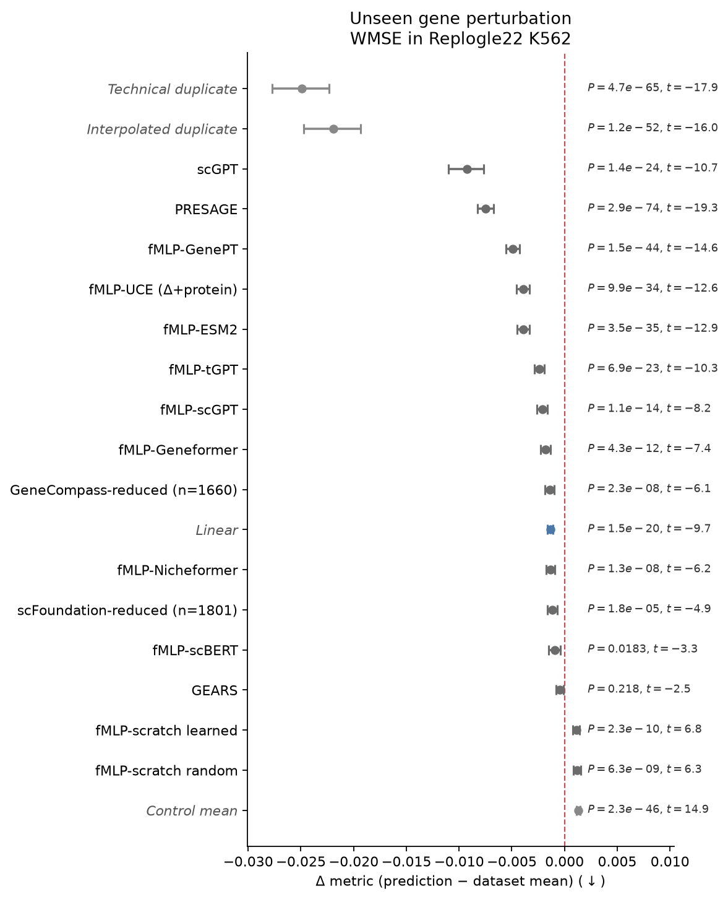

# 扰动模型的 baseline 及性能报告

> 本地 Markdown 稿（与 HTML 同步维护）。线上页：[perturbation-baselines.html](./perturbation-baselines.html) · <https://cangiolo.github.io/archive/perturbation-baselines.html>

## 结论

**结果口径：**下表保留各模型原生覆盖（native）的五折拼接均值，旧列数字不变；扰动数和基因轴不同，不能据此直接排出跨模型名次，也不宣称扩大后的模型排序与论文全部一致。K562 的配对 WMSE 比较另见共同队列森林图。

**评测任务与指标：**本复现覆盖未见单基因扰动三个数据集：HepG2（Nadig25）、K562（Replogle22）、Jurkat（Nadig25）；共 18 个指标。原有 Linear、Mean、GEARS、fMLP–Geneformer 与正负对照保持；新增 scGPT、fMLP–scGPT、fMLP–GenePT、fMLP–ESM2、PRESAGE 仅覆盖 HepG2/K562，每模型每数据集均完成 5/5 折，不扩展 Jurkat。

**本次更新（2026-10-26）：**合入 scGPT 报告（2026-10-25）与其余模型补跑报告（2026-10-26）；PRESAGE 只采用完整五折结果。scLambda 因缺少独立嵌入缓存跳过；CellFlow 因现有运行入口与依赖阻塞跳过，均未训练、无本次结果。


## 现有指标及计算方案

[Miller et al.](https://doi.org/10.1038/s41587-026-03307-w) 用校准后的指标说明：即便较早期的深度模型，在部分指标上也大多能超过无信息 baseline；更新的模型（如 PRESAGE）更进一步。以 Fig. 2b（K562，WMSE）为例，从矩阵到森林图的处理如下。

- **预测矩阵合并为扰动级向量（每轮按扰动计算，不是逐细胞比）。**每个测试扰动把细胞对半：GT 半聚成真值伪批量 $y$（GT），模型输出同维伪批量 $\hat{y}$（预测）。GEARS 等对抽样 control 取均值后再加扰动效应。Mean 基线则是本折训练扰动伪批量的等权平均 $\mu_{\mathrm{all}}$。

- **每个扰动算一次 WMSE。**用 GT 半细胞相对「其余非对照扰动」细胞做 t-test（overestim_var），得到 $t_g$（$|t_g|$ 反映该基因相对其他扰动的特异程度）；对 $|t|$ min–max 后再平方得基因权重 $w_g$（权重只来自 GT，避免泄漏）。然后

$$
\mathrm{WMSE}_i=\frac{\sum_g w_g(\hat y_g-y_g)^2}{\sum_g w_g}.
$$

其中 $\hat y$ 为预测伪批量、$y$ 为 GT 伪批量、$g$ 为基因。对 Mean 用同一套 $y,w$，把 $\hat y$ 换成 $\mu_{\mathrm{all}}$，得到 $\mathrm{WMSE}_i^{\mathrm{Mean}}$。

- **Fig. 2b 画的不是绝对 WMSE，而是差值。**每个扰动：$\Delta_i=\mathrm{WMSE}_i(\text{模型})-\mathrm{WMSE}_i(\text{Mean})$。WMSE 越低越好，所以 $\Delta<0$（点在 0 左侧）= 打过 Mean。图注 $n=2045$ 就是这类成对差值的扰动数。

- **汇总成一行森林图。**对所有 $\Delta_i$ 取均值 $\mu_\Delta$；95% CI 用扰动级 bootstrap（文中 10,000 次）；再对「模型 vs Mean」做配对 t 检验（Bonferroni）。一点 + 横线 = 这一行的 $\mu_\Delta$ 与 CI，不是五折先平均再画。

<details id="k562-wmse-example">
<summary>测评计算示例</summary>
<p><strong>数据集：</strong>Replogle22 K562 的测试扰动 <code>ACTR3</code>，模型为 GEARS。</p>
<p><strong>1．预测矩阵合并为扰动级向量（本例：ACTR3）。</strong>按扰动聚合后，\(y\) 是 GT 真值伪批量，\(\hat y\) 是 GEARS 输出的同维预测伪批量，Mean 基线 \(\mu_{\mathrm{all}}\) 是本折训练扰动伪批量的等权平均。下表列出 ACTR3 对应向量中的基因值，而非逐细胞比较。</p>
<table>
<thead><tr><th scope="col">基因</th><th scope="col">\(y\)（GT）</th><th scope="col">\(\hat y\)（GEARS）</th><th scope="col">\(\mu_{\mathrm{all}}\)（Mean）</th></tr></thead>
<tbody>
<tr><th scope="row">ACTR3</th><td>0.46863884</td><td>1.03306040</td><td>0.99744137</td></tr>
<tr><th scope="row">SASS6</th><td>0.11454315</td><td>0.31217086</td><td>0.32649157</td></tr>
<tr><th scope="row">TBXA2R</th><td>0.17676552</td><td>0.08538473</td><td>0.08957724</td></tr>
<tr><th scope="row">RPAIN</th><td>0.60013849</td><td>0.49888048</td><td>0.51133575</td></tr>
<tr><th scope="row">SZT2</th><td>0.10860045</td><td>0.10138429</td><td>0.08642177</td></tr>
<tr><th scope="row">HNRNPL</th><td>0.53350878</td><td>0.50137216</td><td>0.53313081</td></tr>
</tbody>
</table>
<p><strong>2．每个扰动算一次 WMSE（本例手算子集）。</strong></p>
<p><strong>先给每个基因算一个 t 值，衡量它在 ACTR3 里有多「特别」。</strong>做法是比较两组细胞在这个基因上的表达：</p>
<ul>
<li><strong>ACTR3 组：</strong>ACTR3 的 GT 半细胞，共 \(n_1\) 个，这个基因的平均表达记为 \(\bar x_1\)，方差记为 \(s_1^2\)。</li>
<li><strong>参照组：</strong>数据里其余被敲了别的基因的细胞，共 \(n_2\) 个，平均表达 \(\bar x_2\)，方差 \(s_2^2\)。这里的「非对照扰动」指敲了某个基因的细胞，不包括 control（没敲任何基因、只加了非靶向引导 RNA 的细胞），所以参照组里没有 control。</li>
</ul>
<p>普通的 Welch t 检验是：</p>
$$
t_g=\frac{\bar x_1-\bar x_2}{\sqrt{\dfrac{s_1^2}{n_1}+\dfrac{s_2^2}{n_2}}}.
$$
<p>Miller 用的 <code>t-test_overestim_var</code> 只改了一处：分母里把参照组的细胞数 \(n_2\) 也当成 \(n_1\)：</p>
$$
t_g=\frac{\bar x_1-\bar x_2}{\sqrt{\dfrac{s_1^2+s_2^2}{n_1}}}.
$$
<p>参照组通常有成千上万个细胞，远多于 ACTR3 这一组。按真实的 \(n_2\) 算，\(s_2^2/n_2\) 几乎为零，分母偏小，t 值就偏大。这里假装参照组也只有 \(n_1\) 个细胞，分母变大，t 值变小，也就是把方差估高了，所以叫「方差高估」。目的是细胞少的扰动不会因为偶然波动被判成差异很大。</p>
<p>\(|t_g|\) 越大，说明这个基因在 ACTR3 里相对其他扰动越特别，上调还是下调都算。</p>
<p><strong>再把 \(|t_g|\) 换算成 0 到 1 的权重。</strong>先拿 ACTR3 在全部 8,370 个基因上的 \(|t|\) 排一遍：最小值记为 \(a=0.0000334845463\)，最大值记为 \(b=5.621879577637\)。每个基因的 \(|t_g|\) 都按这两个数缩放到 0 到 1。下面表格只摘了 6 个基因，但 \(a\) 和 \(b\) 仍然取全部 8,370 个基因里的最小和最大值，不取这 6 行里的。否则同一个基因的权重会因为表里摘了哪几行而变化：</p>
$$
u_g=\frac{|t_g|-a}{b-a},\qquad w_g=u_g^2.
$$
<p>归一化值越大，平方后的权重越大。平方会进一步压低较小归一化值的相对权重，更强调强效应、即这里 \(|t_g|\) 较大的基因，并非放大所有基因的权重。</p>
<p>例如 SASS6：\(u_g=(3.51611304-a)/(b-a)\approx0.62543149\)，\(w_g\approx0.39116454\)。</p>
<p><strong>最后计算加权误差。</strong>GEARS 与 Mean 共用同一套真值 \(y\) 和权重 \(w_g\)。先将 GEARS 的逐基因预测误差平方后乘以权重，再求和并除以权重之和；对 Mean 只把预测伪批量 \(\hat y\) 换成训练扰动等权平均 \(\mu_{\mathrm{all}}\)。下表最后两列就是两者分子中的逐基因项：\(A_g=w_g(\hat y_g-y_g)^2\)，\(B_g=w_g(\mu_{\mathrm{all},g}-y_g)^2\)。</p>
<table>
<thead><tr><th scope="col">基因</th><th scope="col">\(|t_g|\)</th><th scope="col">\(u_g\)</th><th scope="col">\(w_g\)</th><th scope="col">\(A_g\)（GEARS）</th><th scope="col">\(B_g\)（Mean）</th></tr></thead>
<tbody>
<tr><th scope="row">ACTR3</th><td>5.62187958</td><td>1.00000000</td><td>1.00000000</td><td>0.31857170</td><td>0.27963212</td></tr>
<tr><th scope="row">SASS6</th><td>3.51611304</td><td>0.62543149</td><td>0.39116454</td><td>0.01527760</td><td>0.01757195</td></tr>
<tr><th scope="row">TBXA2R</th><td>1.88549769</td><td>0.33538168</td><td>0.11248087</td><td>0.00093927</td><td>0.00085506</td></tr>
<tr><th scope="row">RPAIN</th><td>1.16399884</td><td>0.20704326</td><td>0.04286691</td><td>0.00043952</td><td>0.00033805</td></tr>
<tr><th scope="row">SZT2</th><td>0.52619267</td><td>0.09359189</td><td>0.00875944</td><td>0.00000046</td><td>0.00000431</td></tr>
<tr><th scope="row">HNRNPL</th><td>0.00003348</td><td>0.00000000</td><td>0.00000000</td><td>0.00000000</td><td>0.00000000</td></tr>
</tbody>
</table>
<p>例如 ACTR3 对 GEARS 分子的贡献为 \(1\times(1.03306040-0.46863884)^2\approx0.31857170\)。HNRNPL 恰在 min–max 下界，故权重为 0，并非没有预测误差。只对 \(S\) 求和：\(\sum_{g\in S}w_g=1.55527177\)，于是</p>
$$
\begin{aligned}
\mathrm{WMSE}_{i,S}^{\mathrm{GEARS}}&=\frac{0.33522855}{1.55527177}\approx0.21554339,\\
\mathrm{WMSE}_{i,S}^{\mathrm{Mean}}&=\frac{0.29840148}{1.55527177}\approx0.19186452.
\end{aligned}
$$
<p>表内保留 8 位小数；求和、相减使用未舍入原值。这里分母也只加这 6 个基因，故是<strong>子集 WMSE</strong>，不是六项对正式全基因 WMSE 的贡献之和。</p>
<p><strong>3．差值 Δ，不是绝对 WMSE。</strong>用该扰动的 GEARS WMSE 减去 Mean WMSE，得到用于比较模型与基线的差值；本例子集的结果为：</p>
$$
\Delta_{i,S}=\mathrm{WMSE}_{i,S}^{\mathrm{GEARS}}-\mathrm{WMSE}_{i,S}^{\mathrm{Mean}}\approx+0.02367886.
$$
<p>正值表示 GEARS 在这 6 个基因上误差更大；负值才表示优于 Mean。作为口径核对，同一 ACTR3 的<strong>全基因</strong>落盘结果为 GEARS 0.01203250、Mean 0.00917999，\(\Delta_i\approx+0.00285251\)；已用该扰动的完整向量复算吻合，不能用上面的子集数替代。</p>
<p><strong>4．汇总成一行森林图（本例不跑全量）。</strong>正式评估汇总全部测试扰动的全基因 \(\Delta_i\)，取均值 \(\mu_\Delta=n^{-1}\sum_i\Delta_i\)，以扰动为单位有放回重采样得到均值的 95% bootstrap CI，再对「模型 vs Mean」做配对 t 检验（Bonferroni）。森林图的一点和横线分别表示均值与 CI，不是五折先平均再画。下方论文 Fig. 2b 的 \(n=2045\) 是其全量成对差值数，并非本算例的样本数（本次 GEARS 复现五折可评 2029 个）。本块只演示 1 个扰动，不据此算 CI 或做配对 t 检验，也不重跑 10,000 次 bootstrap。</p>
<p><strong>本例数字从哪来。</strong>都在 GPU 机器 <code>gpu-zhouy1</code> 上，目录<br><code>~/Projects/gene_perturb_predict/runs/miller-gears-k562-repro-20261021/</code>：</p>
<ul>
<li><strong>真值、Mean、以及每个基因的 \(t\) 值：</strong>预处理文件 <code>author_formal/data/replogle22k562_processed.h5ad</code>。ACTR3 的 GT 半伪批量、训练扰动的平均表达 \(\mu_{\mathrm{all}}\)、还有算权重用的 \(t_g\) 都在这个文件里。</li>
<li><strong>GEARS 预测：</strong><code>author_formal/folds/fold_0/predictions.csv</code> 里 ACTR3 那一行，按基因名对齐到真值。</li>
<li><strong>全基因 WMSE 对照：</strong><code>author_formal/results/</code> 下的 <code>gears_per_perturbation.csv</code> 和 <code>mean_per_perturbation.csv</code>，取 ACTR3、fold 0 那一行。权重和评分的代码在仓库的 <code>vendor/MillerBenchmark/cellsimbench/core/data_manager.py</code>。</li>
</ul>
</details>


*图 1. Miller et al., Nat Biotechnol（2026），Figure 2b–g（已裁去 a 面板任务示意）。相对 Mean 的森林图：左列 Replogle22 K562 未见单基因；右列 Wessels23 未见组合。*


*图 2. 同文 Extended Data Fig. 6。上排 Replogle22 K562（MSE / Pearson(Δctrl) / NIR）；下排 Nadig25 HepG2（WMSE / 加权 R²Δctrl / NIR / Pearson(Δpert)）。*


*图 3. 同文 Extended Data Fig. 7。仅 Replogle22 K562 未见单基因任务；比较 fMLP 在 GenePT / ESM2 / scGPT / Geneformer 等嵌入与规模下的表现。*

## HepG2（Nadig25）

作者预处理 109,183×8,746；2322 非对照扰动。GEARS / Mean / Inter.Dup / Control / Tech.Dup 来自 GEARS 正式轮拼接；Linear、fMLP–Geneformer 来自各自 REPORT。与 Miller 文印刷表三位小数对照时，非 DEG 多项对齐；DEG 绝对分不对齐。

### 拼接 mean（全 18 项）

数字为扰动等权的五折 pooled mean。Tech.Dup / Inter.Dup 为正对照。旧列保留原报告覆盖及数字：Linear n≈2100 · Mean n≈2302 · GEARS n≈2302 · fMLP–Geneformer n≈2260 · Inter.Dup n≈2302 · Control n≈2302 · Tech.Dup n≈2302；原生基因轴为 8746。新增原生覆盖：scGPT n=2068、8743 基因；fMLP–scGPT n=2277、fMLP–GenePT n=2252、fMLP–ESM2 n=2258、PRESAGE n=2100，后四者均为 8746 基因。各列不是同一扰动支持集，不作配对排名。

| 指标                  | Linear   | Mean     | GEARS    | fMLP–Geneformer | scGPT | fMLP–scGPT | fMLP–GenePT | fMLP–ESM2 | PRESAGE | Inter.Dup | Control  | Tech.Dup |
| ------------------- | -------- | -------- | -------- | --------------- | -------- | -------- | -------- | -------- | -------- | --------- | -------- | -------- |
| MSE                 | 0.009176 | 0.009262 | 0.009773 | 0.009565        | 0.009393 | 0.009432 | 0.008969 | 0.009198 | 0.008288 | 0.008256  | 0.010175 | 0.011582 |
| WMSE                | 0.048182 | 0.048218 | 0.045429 | 0.045157        | 0.039839 | 0.043911 | 0.041104 | 0.043234 | 0.039362 | 0.029393  | 0.051076 | 0.022033 |
| MAE                 | 0.065883 | 0.066002 | 0.068912 | 0.067324        | 0.066454 | 0.067190 | 0.065523 | 0.066078 | 0.064009 | 0.064048  | 0.067635 | 0.078303 |
| WMAE                | 0.151231 | 0.151649 | 0.147979 | 0.143912        | 0.145905 | 0.142484 | 0.136100 | 0.139679 | 0.134684 | 0.133974  | 0.150447 | 0.111575 |
| Pearson(Δctrl)      | 0.287    | 0.262    | 0.206    | 0.188           | 0.253 | 0.207 | 0.199 | 0.209 | 0.308 | 0.294     | 未定义      | 0.299    |
| Pearson(Δpert)      | 0.080    | 未定义      | 0.060    | 0.121           | 0.089 | 0.127 | 0.209 | 0.170 | 0.261 | 0.231     | 0.052    | 0.300    |
| R²(Δctrl)           | 0.027    | 0.012    | −0.089   | −0.048          | 0.010 | −0.049 | 0.006 | −0.017 | 0.077 | 0.063     | −0.010   | −0.398   |
| R²(Δpert)           | −0.003   | −0.010   | −0.115   | −0.077          | −0.024 | −0.076 | −0.023 | −0.042 | 0.053 | 0.052     | −0.068   | −0.406   |
| WR²(Δctrl)          | −0.062   | −0.091   | −0.100   | −0.035          | 0.018 | −0.041 | 0.049 | −0.001 | 0.085 | 0.070     | −0.027   | 0.188    |
| WR²(Δpert)          | −0.012   | −0.026   | −0.035   | 0.016           | 0.063 | 0.015 | 0.095 | 0.055 | 0.135 | 0.147     | −0.007   | 0.267    |
| NIR                 | 0.513    | 0.500    | 0.535    | 0.549           | 0.522 | 0.561 | 0.598 | 0.579 | 0.641 | 0.594     | 0.500    | 0.820    |
| PDS                 | 0.513    | 0.500    | 0.531    | 0.545           | 0.514 | 0.555 | 0.588 | 0.571 | 0.626 | 0.564     | 0.500    | 0.788    |
| MSE(DEGs)           | 0.082    | 0.083    | 0.072    | 0.073           | 0.079 | 0.068 | 0.061 | 0.066 | 0.056 | 0.043     | 0.092    | 0.027    |
| MAE(DEGs)           | 0.190    | 0.190    | 0.182    | 0.177           | 0.185 | 0.173 | 0.161 | 0.168 | 0.159 | 0.145     | 0.192    | 0.119    |
| Pearson(Δctrl DEGs) | 0.396    | 0.382    | 0.287    | 0.239           | 0.420 | 0.262 | 0.251 | 0.260 | 0.399 | 0.543     | 未定义      | 0.493    |
| Pearson(Δpert DEGs) | 0.155    | 未定义      | 0.090    | 0.091           | 0.216 | 0.112 | 0.178 | 0.133 | 0.300 | 0.446     | −0.058   | 0.491    |
| R²(Δctrl DEGs)      | −0.254   | −0.303   | −0.405   | −0.361          | −0.147 | −0.352 | −0.292 | −0.324 | −0.208 | −0.074    | −0.389   | −0.095   |
| R²(Δpert DEGs)      | −0.391   | −0.426   | −0.419   | −0.386          | −0.281 | −0.378 | −0.312 | −0.345 | −0.255 | −0.167    | −0.430   | −0.061   |

**相对 Mean：**GEARS 的 MSE +5.5%、WMSE −5.8%（16 项中胜 7）。相对 Miller 文印刷点：GEARS Pearson(Δctrl) −0.012、NIR −0.011。

## K562（Replogle22）

GO 可评约 2029；Linear n=1855（仅表达靶）；fMLP–Geneformer n=1986（all_embedded，剔除缺嵌入 58）。Inter.Dup 和 Tech.Dup 两列使用作者数据原本覆盖的 2029 个扰动、8370 个基因（native 口径）；与表中其他模型一样，按各自覆盖的扰动汇总，并不是统一到 1802 个扰动的队列。

### 拼接 mean（全 18 项）

数字为扰动等权的五折 pooled mean，旧列数字及覆盖不变：Linear n≈1855 · Mean n≈2029 · GEARS n≈2029 · fMLP–Geneformer n≈1986 · Control n≈2029；原生基因轴为 8370。新增原生覆盖：scGPT n=1825、8369 基因；fMLP–scGPT n=2001、fMLP–GenePT n=1979、fMLP–ESM2 n=1984、PRESAGE n=1855，后四者均为 8370 基因。各列不能直接用于同扰动配对比较。

| 指标                  | Linear   | Mean     | GEARS    | fMLP–Geneformer | scGPT | fMLP–scGPT | fMLP–GenePT | fMLP–ESM2 | PRESAGE | Inter.Dup | Control  | Tech.Dup |
| ------------------- | -------- | -------- | -------- | --------------- | -------- | -------- | -------- | -------- | -------- | -------- | -------- | -------- |
| MSE                 | 0.004814 | 0.004835 | 0.005944 | 0.005040        | 0.005056 | 0.005648 | 0.004635 | 0.004669 | 0.004304 | 0.004057 | 0.005099 | 0.005832 |
| WMSE                | 0.034434 | 0.033802 | 0.033510 | 0.032008        | 0.026330 | 0.032358 | 0.029083 | 0.030004 | 0.028269 | 0.013495 | 0.034976 | 0.010768 |
| MAE                 | 0.047700 | 0.047659 | 0.054299 | 0.048975        | 0.049045 | 0.049079 | 0.047226 | 0.047410 | 0.046274 | 0.045397 | 0.048241 | 0.055533 |
| WMAE                | 0.118511 | 0.118101 | 0.118731 | 0.111511        | 0.112159 | 0.111944 | 0.104720 | 0.107914 | 0.103853 | 0.093317 | 0.117038 | 0.078407 |
| Pearson(Δctrl)      | 0.242    | 0.207    | 0.153    | 0.143           | 0.197 | 0.172 | 0.200 | 0.214 | 0.303 | 0.292 | 未定义      | 0.307 |
| Pearson(Δpert)      | 0.079    | 未定义      | 0.019    | 0.115           | 0.083 | 0.117 | 0.211 | 0.172 | 0.260 | 0.250 | 0.060    | 0.311 |
| R²(Δctrl)           | 0.009    | −0.008   | −0.323   | −0.093          | −0.068 | −0.092 | −0.022 | −0.029 | 0.049 | 0.084 | −0.020   | −0.392 |
| R²(Δpert)           | −0.009   | −0.021   | −0.348   | −0.108          | −0.086 | −0.103 | −0.034 | −0.040 | 0.038 | 0.081 | −0.046   | −0.385 |
| WR²(Δctrl)          | −0.042   | −0.069   | −0.178   | −0.033          | 0.071 | −0.037 | 0.052 | 0.014 | 0.105 | 0.246 | −0.037   | 0.319 |
| WR²(Δpert)          | −0.020   | −0.035   | −0.149   | −0.004          | 0.094 | −0.005 | 0.080 | 0.047 | 0.132 | 0.289 | −0.020   | 0.369 |
| NIR                 | 0.517    | 0.500    | 0.518    | 0.555           | 0.535 | 0.554 | 0.608 | 0.585 | 0.647 | 0.644 | 0.500    | 0.842 |
| PDS                 | 0.518    | 0.500    | 0.516    | 0.552           | 0.522 | 0.551 | 0.598 | 0.578 | 0.634 | 0.593 | 0.500    | 0.810 |
| MSE(DEGs)           | 0.052    | 0.052    | 0.049    | 0.047           | 0.050 | 0.047 | 0.038 | 0.041 | 0.035 | 0.021 | 0.055    | 0.013 |
| MAE(DEGs)           | 0.157    | 0.156    | 0.155    | 0.144           | 0.153 | 0.144 | 0.130 | 0.136 | 0.127 | 0.103 | 0.156    | 0.084 |
| Pearson(Δctrl DEGs) | 0.294    | 0.268    | 0.220    | 0.183           | 0.371 | 0.223 | 0.268 | 0.277 | 0.412 | 0.598 | 未定义      | 0.607 |
| Pearson(Δpert DEGs) | 0.159    | 未定义      | 0.096    | 0.121           | 0.287 | 0.143 | 0.232 | 0.210 | 0.370 | 0.571 | −0.052   | 0.619 |
| R²(Δctrl DEGs)      | −0.201   | −0.260   | −0.378   | −0.263          | −0.090 | −0.256 | −0.164 | −0.199 | −0.069 | 0.156 | −0.286   | 0.174 |
| R²(Δpert DEGs)      | −0.256   | −0.307   | −0.381   | −0.268          | −0.123 | −0.266 | −0.166 | −0.210 | −0.078 | 0.139 | −0.309   | 0.196 |

**比较边界：**不再从不同原生支持集的均值给出模型名次；相对 Mean 的配对结果见下图。

<figure>

<figcaption>图 4. 沿用原图样式与十个已有条目，仅加入 PRESAGE；十一行按平均差值从小到大排列，共用 1802 个测试扰动。逐扰动计算 \(\Delta_i=\mathrm{WMSE}_i(\text{模型})-\mathrm{WMSE}_i(\text{Mean})\)，负值更好。点为差值均值，横线为扰动级 bootstrap 的 95% 百分位置信区间（10,000 次，随机种子 42）。右侧 P 为双侧配对 t 检验经 11 次比较的 Bonferroni 校正值，t 为检验统计量。置信区间未做多重比较校正，不能只看是否跨零判断校正后显著性。红色虚线为 Mean 的零参考，不另画 Mean 行，也不对 Mean 自身做检验。</figcaption>
</figure>
<p>本次只复用已有逐扰动分数，不重新评分。保留原图的 Technical duplicate、Interpolated duplicate、Control mean，以及其余模型的标签、配色与斜体标注。三项对照仍使用 8370 基因的旧分数；其余模型及 Mean 使用 8369 基因的共同轴。这里对齐的是扰动集合，基因轴差异尚未统一，因此不能把全图称为完全同口径的公平比较。上表仍按各模型原生覆盖汇总，不能直接用表中均值相减来复原图中差值。<a href="../assets/img/perturbation-baselines/k562-wmse-forest-original-style.csv">逐行统计值</a>与<a href="../assets/img/perturbation-baselines/k562-wmse-forest-original-style.meta.json">数据来源及绘图协议</a>一并保留。</p>

## Jurkat（Nadig25）

Miller 文印刷表 **无** Jurkat 的 Linear/GEARS/fMLP 行。下表为 Linear 报告中的**共同支持集 n=2108**（六模型同扰动）；fMLP–Geneformer 不在该 matched 表内，另列 all_embedded n=2283。

### 拼接 mean（matched n=2108）

同集公平比较；Inter.Dup / Tech.Dup 为正对照。 可评规模：Linear n≈2108 · Mean n≈2108 · GEARS n≈2108 · Inter.Dup n≈2108 · Control n≈2108 · Tech.Dup n≈2108。

| 指标                  | Linear   | Mean     | GEARS    | Inter.Dup | Control  | Tech.Dup |
| ------------------- | -------- | -------- | -------- | --------- | -------- | -------- |
| MSE                 | 0.008155 | 0.008265 | 0.009916 | 0.007653  | 0.008852 | 0.011440 |
| WMSE                | 0.051241 | 0.052720 | 0.051595 | 0.026     | 0.055263 | 0.022    |
| MAE                 | 0.063023 | 0.063274 | 0.071463 | 0.062132  | 0.064510 | 0.077350 |
| WMAE                | 0.148972 | 0.150581 | 0.151579 | 0.129479  | 0.150582 | 0.110300 |
| Pearson(Δctrl)      | 0.246    | 0.236    | 0.167    | 0.290     | 未定义      | 0.286    |
| Pearson(Δpert)      | 0.050    | 未定义      | 0.016    | 0.211     | 0.031    | 0.273    |
| R²(Δctrl)           | 0.013    | 0.010    | −0.254   | 0.063     | −0.020   | −0.433   |
| R²(Δpert)           | −0.014   | −0.020   | −0.295   | 0.039     | −0.065   | −0.461   |
| WR²(Δctrl)          | −0.050   | −0.060   | −0.137   | 0.195     | −0.054   | 0.280    |
| WR²(Δpert)          | −0.040   | −0.053   | −0.129   | 0.213     | −0.064   | 0.303    |
| NIR                 | 0.509    | 0.500    | 0.517    | 0.586     | 0.500    | 0.806    |
| PDS                 | 0.508    | 0.500    | 0.513    | 0.538     | 0.500    | 0.769    |
| MSE(DEGs)           | 0.067    | 0.070    | 0.067    | 0.038     | 0.074    | 0.025    |
| MAE(DEGs)           | 0.177    | 0.180    | 0.182    | 0.140     | 0.182    | 0.115    |
| Pearson(Δctrl DEGs) | 0.337    | 0.324    | 0.241    | 0.600     | 未定义      | 0.588    |
| Pearson(Δpert DEGs) | 0.126    | 未定义      | 0.076    | 0.519     | −0.080   | 0.575    |
| R²(Δctrl DEGs)      | −0.278   | −0.295   | −0.413   | 0.055     | −0.352   | 0.094    |
| R²(Δpert DEGs)      | −0.351   | −0.367   | −0.430   | 0.008     | −0.385   | 0.102    |

### fMLP–Geneformer（Jurkat，另口径）

fMLP–Geneformer all_embedded n=2283（缺嵌入 −63）。勿与上表 n=2108 硬比。无文中印刷对照行。

| 指标                  | fMLP–Geneformer |
| ------------------- | --------------- |
| MSE                 | 0.008447        |
| WMSE                | 0.047257        |
| MAE                 | 0.064283        |
| WMAE                | 0.142419        |
| Pearson(Δctrl)      | 0.179           |
| Pearson(Δpert)      | 0.082           |
| R²(Δctrl)           | −0.090          |
| R²(Δpert)           | −0.110          |
| WR²(Δctrl)          | −0.056          |
| WR²(Δpert)          | −0.035          |
| NIR                 | 0.535           |
| PDS                 | 0.530           |
| MSE(DEGs)           | 0.061           |
| MAE(DEGs)           | 0.166           |
| Pearson(Δctrl DEGs) | 0.249           |
| Pearson(Δpert DEGs) | 0.100           |
| R²(Δctrl DEGs)      | −0.344          |
| R²(Δpert DEGs)      | −0.357          |

**内部序（matched）：**Pearson Inter.Dup > Tech.Dup > Linear > Mean > GEARS；NIR Tech.Dup ≫ Inter.Dup > GEARS ≳ Linear ≈ Mean。

## 模型配置

表中模型名可悬停；完整配置如下。

### Mean

**Dataset Mean（负对照）。**训练扰动伪批量的等权平均；Miller 用作负对照。

```
定义                   本折训练非对照扰动的 pseudobulk 等权平均
加权                   不按细胞数加权
注意                   Pearson(Δpert) 对自身未定义
```

### Control

**Control Mean（负对照）。**对照细胞均值基线。

```
定义                   作者 ctrl_baseline
注意                   Pearson(Δctrl) 对自身未定义（预测位移为零向量）
```

### Tech.Dup

**Technical duplicate（正对照）。**同一扰动的细胞对半分：一半当真值，另一半当「预测」——这是实验能摸到的上限。

```
半分裂                 first_half=GT · second_half=TD
DEG 权重               TD 不参与，避免泄漏
```

### Inter.Dup

**Interpolated duplicate（正对照）。**TD 与 Mean 按 DEG 显著性逐基因插值；用于指标校准。

```
公式                   μ_ID = α ⊙ μ_TD + (1−α) ⊙ μ_all
α                      1 − P_DEG（仅用 TD 半独立 DEG）
弱扰动                 贴近 Mean
强扰动                 贴近 Tech.Dup
```

**数据集对应训练：**GEARS / fMLP–Geneformer / Linear 均在 HepG2、K562、Jurkat 上分别拟合五折；新增 scGPT / fMLP–scGPT / fMLP–GenePT / fMLP–ESM2 / PRESAGE 仅在 HepG2、K562 上各完成五折。Mean / Control / Tech.Dup / Inter.Dup 为派生基线，不是可学习模型。
### Linear

**Ahlmann-Eltze Linear。**伪批量 PCA（10 维）加岭回归 Y≈G W P。

```
PCA                    n_components=10, random_state=42
ridge                  G_ridge=P_ridge=0.1
靶基因                 仅表达矩阵中出现的靶；缺行不补零
对齐                   HepG2/K562 非 DEG 12 项对齐印刷表三位小数
```

### GEARS

**GEARS 0.1.2（原生）。**每个数据集（HepG2 / K562 / Jurkat）独立五折训练与评分。

```
hidden                 64
GO / Gene GNN          各 1 层
decoder                16
两图邻居               20
coexpression 阈值      0.4
epochs                 10
batch                  32
optimizer              Adam lr=0.001, weight_decay=0.0005
scheduler              StepLR 每 epoch ×0.5
loss                   原生四次方 + direction_lambda=0.1
uncertainty            False
checkpoint             val top20-DE MSE
共表达图               仅本折 train 细胞
predict                对 300 个抽样 control 取均值
```

### fMLP–Geneformer

**fMLP + Geneformer-V2-104M。**冻结 Geneformer 词嵌入，其上训练 MLP probe。

**Geneformer-V2-104M：**静态 `word_embeddings`（20,271×768）查表，无训练。

**来源：**Christina Theodoris 实验室在 Hugging Face 发布的官方权重（[ctheodoris/Geneformer](https://huggingface.co/ctheodoris/Geneformer)，子目录 `Geneformer-V2-104M`）。

**训练时间：**约 2024 年 12 月在 [Genecorpus-104M](https://huggingface.co/datasets/theodoris-lab/Genecorpus-104M) 上预训练。

**预训练语料：**约 1.04 亿（103,877,737）人类单细胞转录组，来自 2903 个公开数据集（GEO / SRA / CELLxGENE / HCA 等），不含高突变负荷细胞（恶性细胞、永生化细胞系）；词表约 20,271 个蛋白编码基因。

**预训练算力：**FP32；DeepSpeed 分布式；8–24× NVIDIA H100 80GB；GF-104M 共 3 epochs（Chen & Venkatesh et al., *Nat Comput Sci* 2026；原文未报总 GPU-hours）。

```
嵌入                   Geneformer-V2-104M word_embeddings（HF 官方）
查表                   作者 h5ad 内 20,271×768 静态；不微调 Transformer
网络                   768→512→512→128(latent)→512→512→全部输出基因
激活                   LeakyReLU(0.2)
loss                   绝对表达 MSE
optimizer              Adam lr=0.001
batch                  256
scheduler              StepLR 每 30 epochs ×0.2
seed                   42
epochs                 100
缺嵌入剔除             HepG2 −62 · K562 −58 · Jurkat −63
```

### scGPT

**scGPT whole-human 全参数微调。**使用作者发布的 whole-human 预训练权重，微调整个模型，不是只训练表达头。扰动编码器沿用官方带层归一化的实现。

```
底模                   scGPT v0.2.4，whole-human
网络                   Transformer 12 层、8 个注意力头；嵌入/前馈宽度 512
正则化                 dropout=0.2
训练范围               全部模型参数
优化器                 Adam，学习率 0.0001，权重衰减 0
学习率                 StepLR 每 15 轮 ×0.9；本次 10 轮内不衰减
轮数 / 批大小 / 种子  10 / 32 / 42，不提前停止
训练目标               所有输入位置的表达平方误差求和
验证与选权重           每轮验证；各批损失等权平均，选验证损失最小的权重
数值设置               混合精度训练；梯度范数裁剪上限 1.0
训练输入               保留零表达基因；超过 1200 基因时每批随机取 1200
验证输入               按原顺序取前 1200 基因
预测                   每扰动有放回抽 300 个对照细胞，分批预测取均值；不裁至 1200
原生覆盖（扰动×基因） HepG2 2068×8743；K562 1825×8369
```

### fMLP–scGPT

**冻结 scGPT 嵌入的 fMLP。**直接使用作者提供的 512 维冻结基因嵌入。生成脚本指向持续预训练（continual-pretrained）版本，与上面的 whole-human 微调不是同一权重口径，不能换用 whole-human 重建特征。

```
输入                   作者提供的 512 维基因嵌入
训练范围               嵌入冻结，只训练 MLP，不微调预训练 Transformer
编码器                 512→512→512→128
解码器                 128→512→512→全部输出基因
激活                   隐藏层 LeakyReLU(0.2)；瓶颈与最终输出无该激活
训练目标               绝对表达 MSE，取平均，不加 DEG 权重
优化器                 Adam，学习率 0.001，权重衰减 0
学习率                 StepLR 每 30 轮 ×0.2
轮数 / 批大小 / 种子  100 / 256 / 42
验证与选权重           每 10 轮验证；各批 MSE 等权平均，选验证损失最小的权重
预测                   基因嵌入与零对照分别编码，相加后解码；保留零输入的偏置
缺嵌入剔除             HepG2 −45；K562 −43；不以零向量或均值补缺失靶点
原生覆盖（扰动×基因） HepG2 2277×8746；K562 2001×8370
```

### fMLP–GenePT

**冻结 GenePT 嵌入的 fMLP。**直接使用作者提供的 GenePT 冻结嵌入表（19,447 个基因、每个 3,072 维），没有调用嵌入生成 API。

```
输入                   作者提供的 3072 维基因嵌入
训练范围               嵌入冻结，只训练 MLP，不微调预训练 Transformer
编码器                 3072→512→512→128
解码器                 128→512→512→全部输出基因
激活                   隐藏层 LeakyReLU(0.2)；瓶颈与最终输出无该激活
训练目标               绝对表达 MSE，取平均，不加 DEG 权重
优化器                 Adam，学习率 0.001，权重衰减 0
学习率                 StepLR 每 30 轮 ×0.2
轮数 / 批大小 / 种子  100 / 256 / 42
验证与选权重           每 10 轮验证；各批 MSE 等权平均，选验证损失最小的权重
预测                   基因嵌入与零对照分别编码，相加后解码；保留零输入的偏置
缺嵌入剔除             HepG2 −70；K562 −65；不以零向量或均值补缺失靶点
原生覆盖（扰动×基因） HepG2 2252×8746；K562 1979×8370
```

### fMLP–ESM2

**冻结 ESM2 嵌入的 fMLP。**直接使用作者提供的 ESM2 冻结嵌入表（19,872 个基因、每个 5,120 维），采用标准大小的 MLP。

```
输入                   作者提供的 5120 维基因嵌入
训练范围               嵌入冻结，只训练 MLP，不微调预训练 Transformer
编码器                 5120→512→512→128
解码器                 128→512→512→全部输出基因
激活                   隐藏层 LeakyReLU(0.2)；瓶颈与最终输出无该激活
训练目标               绝对表达 MSE，取平均，不加 DEG 权重
优化器                 Adam，学习率 0.001，权重衰减 0
学习率                 StepLR 每 30 轮 ×0.2
轮数 / 批大小 / 种子  100 / 256 / 42
验证与选权重           每 10 轮验证；各批 MSE 等权平均，选验证损失最小的权重
预测                   基因嵌入与零对照分别编码，相加后解码；保留零输入的偏置
缺嵌入剔除             HepG2 −64；K562 −60；不以零向量或均值补缺失靶点
原生覆盖（扰动×基因） HepG2 2258×8746；K562 1984×8370
```

### PRESAGE

**40 个固定先验的 PRESAGE。**将作者提供的 40 个先验整合后预测扰动表达，训练的是先验整合与预测网络，不是预训练 Transformer。这里记录实际采用的配置；两数据集均使用完整五折结果，不混入早期单折汇报。

```
输入                   40 个固定预计算先验，用 PCA 降到 128 维
网络                   单项表示宽度 512；通路网络 2 层、每层 128；汇总网络 2 层
先验整合               图注意力（GAT）加权，求和汇总
加权参数               温度 0.15，GAT 权重 0.85
训练目标               表达误差、方向、向量长度和单扰动相加约束；权重均为 1
最多轮数 / 批大小     1000 / 32
随机种子               42
提前停止               验证损失连续 10 轮不改善即停止
HepG2 实际轮数         五折依次为 17 / 15 / 17 / 22 / 19
K562 实际轮数          五折依次为 17 / 18 / 21 / 19 / 19
预测使用权重           停止时的末轮权重，重新加载后预测；不是最佳验证权重
训练采样               每轮打乱样本，丢弃不足一批的尾部样本
原生覆盖（扰动×基因） HepG2 2100×8746；K562 1855×8370
```


## 指标释义（18 项）

下列定义对齐 Miller Methods 与本复现 REPORT：真值为 GT 半伪批量；对照为 `ctrl_baseline`；Δpert 参考本折训练 Mean；权重为 GT |t| min–max 后再平方；DEG 为 adjusted-P 最小 100 个；R² 下限 −1；NIR/PDS 严格小于、排除自身、平局不计。公式按操作定义写出；加权与检索的实现细节以 REPORT / 上游 `data_manager.py` 为准。

### MSE：均方误差

意义：预测与真值在全部基因上的均方误差，越低越好。

计算过程：对每个测试扰动，取 GT 半的伪批量表达 y 与预测 ŷ，在全基因组上算 (ŷ−y)² 的均值；再对扰动等权平均。

公式：

$$
\mathrm{MSE}(\hat y,y)=\frac1G\sum_{g=1}^{G}(\hat y_g-y_g)^2
$$

### WMSE：加权均方误差

意义：按扰动效应强弱给基因加权的 MSE，强调强扰动基因上的误差。

计算过程：权重来自 GT 半相对其余非对照扰动的 t-test\_overestim\_var：对 |t| 做 min–max 归一化后再平方；再算加权 MSE。Miller Methods 称 weighted error metrics 与先验 WMSE 工作一致。

公式：

$$
w_g=\Bigl(\mathrm{minmax}(|t_g|)\Bigr)^2,\quad \mathrm{WMSE}=\frac{\sum_g w_g(\hat y_g-y_g)^2}{\sum_g w_g}
$$

### MAE：平均绝对误差

意义：全基因绝对误差均值；Miller 认为整体校准弱于 MSE。

计算过程：与 MSE 相同的 y / ŷ，改为 |ŷ−y| 的均值。

公式：

$$
\mathrm{MAE}(\hat y,y)=\frac1G\sum_{g=1}^{G}|\hat y_g-y_g|
$$

### WMAE：加权平均绝对误差

意义：与 WMSE 同权重的加权 MAE。

计算过程：权重定义同 WMSE；误差改为绝对误差。

公式：

$$
\mathrm{WMAE}=\frac{\sum_g w_g|\hat y_g-y_g|}{\sum_g w_g}
$$

### Pearson(Δctrl)：相对对照的 Pearson 相关

意义：预测与真值相对对照基线的位移向量的相关系数；衡量方向与相对幅度。

计算过程：Δctrl：ŷ−μ\_c 与 y−μ\_c，μ\_c 为对照细胞均值（ctrl\_baseline）。零向量时未定义（如 Control 自身）。

公式：

$$
\mathrm{Pearson}(\Delta\mathrm{ctrl})=\mathrm{corr}(\hat y-\mu_c,\; y-\mu_c)
$$

### Pearson(Δpert)：相对训练均值的 Pearson 相关

意义：相对本折训练扰动均值 μ\_all 的位移相关；用于减弱对照偏置。

计算过程：Δpert：ŷ−μ\_all 与 y−μ\_all。Mean 基线自身该指标未定义。

公式：

$$
\mathrm{Pearson}(\Delta\mathrm{pert})=\mathrm{corr}(\hat y-\mu_{\mathrm{all}},\; y-\mu_{\mathrm{all}})
$$

### R²(Δctrl)：相对对照的决定系数

意义：Δctrl 空间上的拟合优度；惩罚尺度偏差。

计算过程：在 Δctrl 向量上算 R²；本复现实现下限截断为 −1。

公式：

$$
R^2(\Delta\mathrm{ctrl})=1-\frac{\lVert(\hat y-\mu_c)-(y-\mu_c)\rVert_2^2}{\lVert(y-\mu_c)-\overline{(y-\mu_c)}\rVert_2^2}\quad(\ge -1)
$$

### R²(Δpert)：相对训练均值的决定系数

意义：Δpert 空间上的 R²。

计算过程：参考基线换为本折 μ\_all；同样截断 −1。

公式：

$$
R^2(\Delta\mathrm{pert})=1-\frac{\lVert(\hat y-\mu_{\mathrm{all}})-(y-\mu_{\mathrm{all}})\rVert_2^2}{\mathrm{Var}(y-\mu_{\mathrm{all}})}\quad(\ge -1)
$$

### WR²(Δctrl)：加权 R²（Δctrl）

意义：与 WMSE 同权重的加权 R²，在对照位移上评估。

计算过程：基因权重 w\_g 同 WMSE；在 Δctrl 上算加权残差与加权总变差。

公式：

$$
\mathrm{WR}^2(\Delta\mathrm{ctrl})=1-\frac{\sum_g w_g\bigl((\hat y_g-\mu_{c,g})-(y_g-\mu_{c,g})\bigr)^2}{\sum_g w_g(y_g-\mu_{c,g}-\overline{\cdot})^2}
$$

### WR²(Δpert)：加权 R²（Δpert）

意义：加权 R²，参考为本折训练均值。

计算过程：权重同 WMSE；位移相对 μ\_all。

公式：

$$
\mathrm{WR}^2(\Delta\mathrm{pert})=1-\frac{\sum_g w_g\bigl((\hat y_g-\mu_{\mathrm{all},g})-(y_g-\mu_{\mathrm{all},g})\bigr)^2}{\sum_g w_g(y_g-\mu_{\mathrm{all},g}-\overline{\cdot})^2}
$$

### NIR：归一化逆秩（检索）

意义：预测是否在欧氏距离上最近于正确扰动真值；反映全局扰动景观结构。

计算过程：对每个预测，算到所有候选 GT 的 L2 距离；正确匹配距离严格小于其余（排除自身）计成功；平局不计。拼接口径用全汇集候选。

公式：

$$
\mathrm{NIR}=\mathbb{P}\bigl[\,d_2(\hat y,y_i)\lt d_2(\hat y,y_j)\;\forall j\neq i\,\bigr]
$$

### PDS：扰动判别分数

意义：与 NIR 同结构，距离改为曼哈顿距离（L1）；STATE / VCC 所用。

计算过程：严格小于、排除自身、平局不计；与 NIR 仅距离定义不同。

公式：

$$
\mathrm{PDS}=\mathbb{P}\bigl[\,d_1(\hat y,y_i)\ltd_1(\hat y,y_j)\;\forall j\neq i\,\bigr]
$$

### MSE(DEGs)：均方误差（DEGs）

意义：只在 top-100 DEG 子集上的 MSE。

计算过程：DEG 取 GT 半 adjusted-P 最小的 100 个基因；子集上算未加权 MSE。绝对分常与 Miller 文印刷 DEG 不对齐。

公式：

$$
\mathrm{MSE}_{\mathrm{DEG}}=\frac1{100}\sum_{g\in\mathrm{DEG}_{100}}(\hat y_g-y_g)^2
$$

### MAE(DEGs)：平均绝对误差（DEGs）

意义：top-100 DEG 上的 MAE。

计算过程：同一 DEG 子集，改绝对误差。

公式：

$$
\mathrm{MAE}_{\mathrm{DEG}}=\frac1{100}\sum_{g\in\mathrm{DEG}_{100}}|\hat y_g-y_g|
$$

### Pearson(Δctrl DEGs)：DEG 上相对对照 Pearson

意义：DEG 子集上的 Pearson(Δctrl)。

计算过程：仅在 top-100 DEG 维上算 corr(ŷ−μ\_c, y−μ\_c)。

公式：

$$
\mathrm{corr}\bigl((\hat y-\mu_c)_{\mathrm{DEG}},\,(y-\mu_c)_{\mathrm{DEG}}\bigr)
$$

### Pearson(Δpert DEGs)：DEG 上相对均值 Pearson

意义：DEG 子集上的 Pearson(Δpert)。

计算过程：参考 μ\_all；Mean 自身未定义。

公式：

$$
\mathrm{corr}\bigl((\hat y-\mu_{\mathrm{all}})_{\mathrm{DEG}},\,(y-\mu_{\mathrm{all}})_{\mathrm{DEG}}\bigr)
$$

### R²(Δctrl DEGs)：DEG 上 R²(Δctrl)

意义：DEG 子集上的 R²(Δctrl)，下限 −1。

计算过程：同一 DEG 掩码。

公式：

$$
R^2\bigl((\hat y-\mu_c)_{\mathrm{DEG}},\,(y-\mu_c)_{\mathrm{DEG}}\bigr)\quad(\ge -1)
$$

### R²(Δpert DEGs)：DEG 上 R²(Δpert)

意义：DEG 子集上的 R²(Δpert)，下限 −1。

计算过程：同一 DEG 掩码。

公式：

$$
R^2\bigl((\hat y-\mu_{\mathrm{all}})_{\mathrm{DEG}},\,(y-\mu_{\mathrm{all}})_{\mathrm{DEG}}\bigr)\quad(\ge -1)
$$

## 口径与注意

- **n 与基因轴不同：**Linear/PRESAGE 受可预测靶点约束；各 fMLP 剔除缺嵌入靶点；GEARS 受 GO 覆盖限制；scGPT 还受基因映射与表达面板约束。原生表只描述覆盖，不是同扰动公平比较；scGPT 缺失输出基因不补零或 Mean。

- **论文对照：**部分非 DEG 指标接近论文打印值，但 DEG、相关和 R² 等仍有差异；论文每模型 n 未公布，不能把本地 n 当作论文 n，也不能由局部接近推断所有数值或排序一致。

- **HepG2 GEARS fold0：**首次 predict 时同卡 vLLM OOM；checkpoint 已恢复，`train_seconds` 为空，10 epoch 日志确认完成。

- **共同扰动集合：**K562 森林图的十一行对齐到 1802 个扰动；沿用原图三项对照的 8370 基因分数，其余模型及 Mean 为 8369 基因，差异尚未统一。native 表不以共同集合数替换；本次没有重评分，旧 COMPARE 文档未重写。

- **划分与环境差异：**沿用本地约 70:10:20 五折划分，作者代码实际约 69:11:20；test 成员相同不代表 train/validation 完全相同。新模型不在作者原 Docker 中运行：scGPT/fMLP 使用现有 torch 2.11.0 环境，scGPT 用原生 SDPA 而非 flash-attn；PRESAGE 使用独立 torch 2.2.0 环境。评分另用固定 NumPy 1.26.4 / pandas 2.2.3 环境，不宣称历史运行位级等价。

## 参考

\[1]. Miller et al., *Nat Biotechnol* 2026. doi:[10.1038/s41587-026-03307-w](https://doi.org/10.1038/s41587-026-03307-w)；补充材料 Supplementary Table 2（Springer 曾标为 MOESM4）。

\[2]. Ahlmann-Eltze et al., *Nat Methods* 2025（Linear baseline）。

\[3]. Theodoris et al., Geneformer；本复现用 V2-104M 静态词嵌入。权重：[ctheodoris/Geneformer](https://huggingface.co/ctheodoris/Geneformer)（`Geneformer-V2-104M`）；语料：[Genecorpus-104M](https://huggingface.co/datasets/theodoris-lab/Genecorpus-104M)；论文：Chen & Venkatesh et al., *Nat Comput Sci* 2026。

\[4]. 本复现 REPORT：HepG2/K562/Jurkat GEARS、Linear、fMLP–Geneformer；`RANKING.zh.md`（2026-10-22）。

\[5]. scGPT / fMLP–scGPT 正式报告（2026-10-25）：GPU `gpu-zhouy1` 的 `~/Projects/gene_perturb_predict/runs/miller-scgpt-20261024/REPORT.zh.md`，方法 §1.2、原生结果 §6.2 / §7.2；逐模型评分 `{hepg2,k562}/evaluation/native/{scgpt,fmlp_scgpt}/`。

\[6]. 其余模型补跑报告（2026-10-26）：同机 `runs/miller-remaining-20261026/REPORT.zh.md`。fMLP–GenePT / ESM2 原生结果及更高打印精度的 scGPT 数值取 `{hepg2,k562}/evaluation_stage1/all8_r1/paper_comparison.csv` 的 native 行；PRESAGE 取 `{hepg2,k562}/evaluation_presage/full5_r1/paper_comparison.csv` 的 native 五折行，不取历史 `fold0_trial_r1`。PRESAGE 配置见 `hepg2/presage/folds/fold_0/manifest.json` 的 config；逐折实际轮数见报告全折进度块。
